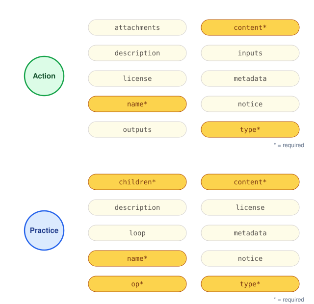
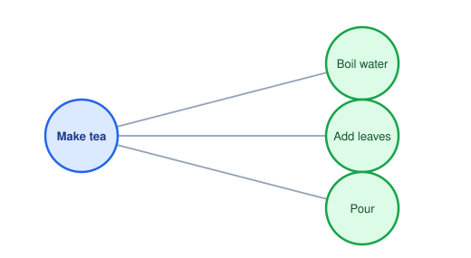
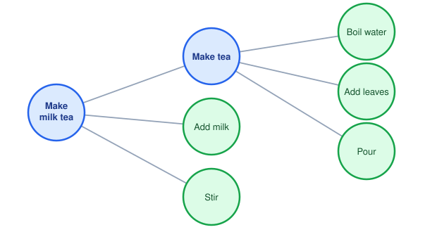
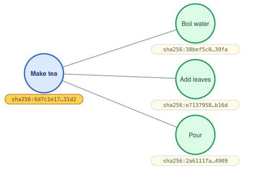

# POP — Protocol of Practice

<b>English</b> | <a href="README.zh-CN.md">中文</a>

A protocol that defines practice knowledge — "how to do a thing" — as open data: publishable, linkable, verifiable, composable.

**Skill-compatible**: every POP document reads as a skill — an action is an atomic skill, a practice is a compositional skill (a skill that composes skills). A skill maps losslessly **into** a document (`name`/`description`/body → `name`/`description`/`content`, files → `attachments`), gaining verifiable identity, linking, and composition in exchange. The reverse direction is a **projection**: a document's flow wiring and op composition have no skill-side serialization — reading a document as a skill is a view of it, not a lossless encoding. The mapping defines identity, it is not an import channel: tools replay exports only — foreign skills enter POP by authoring.

**The protocol: [`pop-spec.md`](pop-spec.md)** — the sole normative definition, version 2.2.0. The spec covers only the protocol; everything else lives here.

## POP at a glance

A POP document is one JSON tree. Leaves are **actions** — atomic steps; interior nodes are **practices** — compositions. Every field of both node types:



Composition is an operator on children — `op` ∈ {`seq`, `par`, `choice`, `loop`, `set`}. "Make tea" is a `seq` of three actions:



Practices nest practices — "Make milk tea" uses the whole "Make tea" practice as one of its steps:



Nodes carry no ids: a node's content hash is its only address, and the root hash is a Merkle root over the whole tree — same hash ⇒ same content, descendants included (§3 of the spec):



## Quick start

```bash
npm install -g @arshdelight/practi
practi new make-tea --base tea.json -m "first"  # birth a practice folder from a document (the tree above, saved as tea.json)
practi web                                     # browse it in a local web UI
```

Agent-first: point your AI agent at the [use-practi skill](skills/use-practi/SKILL.md) — `practi skill install` puts it where agents look (default: `~/.agents/skills`), and the skill walks the agent through every later record / search / review operation.

## What's in this repo

```
pop-spec.md              the specification
sdk/                     @arshdelight/pop-sdk — the official SDK + its conformance test suite
cli/                     practi — the `practi` CLI: practice folders with local history + optional hub sync (built on the SDK)
skills/                  installable agent skill (use-practi)
examples/                seed documents
```

**The protocol is just a convention**: writing a practice requires no code — a practice is a JSON document, zero hashes required to start. The official SDK implements the spec; any other implementer — hub, desktop app, third-party tool — may build on the SDK or from the spec alone. The spec is the sole normative definition.

## sdk/ — @arshdelight/pop-sdk

The spec-verified implementation of parsing, hashing, validation and aggregation (document import, the content-addressed store, aggregate views). Its test suite doubles as the conformance harness:

1. Re-verifies the Appendix A test vectors (hashes hard-coded in the suite, regenerated by `sdk/scripts/vectors.ts`)
2. Verifies the spec is self-consistent: export/import round-trips, validation invariants, aggregation semantics

First-party tooling (`cli/`) depends on it; correctness is locked by the spec and the vector tests, so the spec stays normative rather than being eclipsed by implementation drift.

```bash
npm run build -w @arshdelight/pop-sdk   # dist/ — importable as @arshdelight/pop-sdk
npm test -w @arshdelight/pop-sdk        # vitest (incl. Appendix A vector re-verification)
```

## cli/ — practi (the `practi` command)

**Practice folders with full local history, with an optional hub.** A practice is a self-contained folder you own: the POP is a plain JSON file edited with any editor, and the history lives beside it like `.git`. Nothing leaves the machine except the syncs you ask for (`push` / `pull` / `clone` against a hub such as [practihub](https://practihub.com)).

```
green-tea/
  green-tea.json      the pop — a plain document, edit it with anything
  .practi/            the history (like .git):
    chain.json          commits {seq, root, parent, message} + branch pointers
    nodes/              every revision, content-addressed (hash = identity)
    blobs/              attachment bytes
```

The working file and the head usually match; when they don't, you have **uncommitted changes** — `practi commit` snapshots them as a new revision. The config home (`~/.practi`) only holds `practi.json` (remote), `practi.auth.json` (credentials) and `practi.client.json` (the registered OAuth client, reused across logins); practices are plain folders wherever you keep your documents.

```bash
npm install -g @arshdelight/practi
```

```bash
birth · edit · sync (run inside a practice folder unless noted)
  practi new <name> [--base <file.json>] [-m <msg>]  birth a practice folder in cwd;
                                   --base seeds the first revision from a pop document
  practi commit [-m <msg>] [--amend]   snapshot the working file as a new revision
                                   (local only; nothing to commit when it matches the
                                   head; --amend replaces the head instead)
  practi export <hash> [-o <file>]       write any revision back out as a document
  practi push [--force]            sync to the hub (first push creates the instance there)
  practi pull                      fetch missing revisions, fast-forward, update the
                                   working file (refuses when it has uncommitted changes)
  practi clone <owner>/<name>[@branch] [--dir <path>]
                                   clone a hub practice into a local folder (full chain);
                                   just <name> = one of your own

history
  practi log [--branch <b>] [--limit N] [--json]   commits, tip first
  practi branch [name] [-d <name>] [--from <hash>]   list (* = current) / create / delete
  practi switch <branch>           switch branches; the working file follows the head
                                   (refuses when dirty — commit first)
  practi merge <branch>            fast-forward, else a pointer move (same-tree commits
                                   are identical — POP §9.1: one row per root)
  practi history reword <seq> -m <msg> | squash <seq> | drop <seq> | reset <seq>
                                   rewrite the local chain; the working file is left as
                                   is (git reset semantics) — keep it with a commit or
                                   discard it with export

straight from the hub (an address — <owner>/<name>[@branch] — needs no local folder)
  practi show <owner>/<name>[@branch] [--rev <hash|vN>] [--json] [--doc]
                                   inspect a hub revision: default the branch head,
                                   vN = the Nth revision; --doc prints the document
                                   JSON and hints the --base for the next commit
  practi log <owner>/<name>[@branch] [--limit N] [--json]
                                   the hub revision history, tip first (dated)
  practi set <owner>/<name> [--name <n>] [--description <text>] [--refines <hash>]
                                   update instance metadata (--description "" clears)

inside a practice folder
  practi show <hash> [--json] [--doc]   inspect one revision node (hash prefix OK)
  practi search [query...] [--json]     search this practice's revisions (BM25, title-first,
                                   multi-word AND across fields, field: scoping, hash
                                   prefixes, labeled partial-match tier; --notes includes
                                   local notes)
  practi similar <hash>         content neighbours within this practice (literal bigram
                                   similarity — a paraphrase will not surface)
  practi lint                   quality hints on the current branch head (read-only, always
                                   exits 0 — a to-do list, not a gate)
  practi note add|list|edit|delete   learning notes pinned to node hashes (.practi/notes.json,
                                   never uploaded; the notes sidebar in `practi web` writes
                                   the same file)
  practi blob add <file-or-url> [--name <name>]   store attachment bytes (.practi/blobs/)
  practi gc [--apply]           free orphan blobs (dry-run by default)
  practi web [--port 4317]      browse practices locally: inside a practice folder it serves
                                   the commit chain, branches, and the per-revision reader
                                   (wizard / standard view / tree); anywhere else it serves
                                   the practices home (default ~/.practi/practices) as a
                                   directory page — click through to the reader

anywhere
  practi remote set <url> | remove    point at another hub (default: https://practihub.com;
                                   remove falls back to it)
  practi login [--no-open] [--reauth]   OAuth sign-in (PKCE, browser consent); logout revokes
  practi me                     show the signed-in account, config home and remote
  practi ls [--remote] [--json]  cross-practice overview from the practices home
                                (branch / head / revisions / unpushed per practice);
                                --remote lists your practices on the hub instead
  practi search --remote [query...] [--limit N] [--json]
                                practices on the hub — public ones (hub ranking) plus
                                yours by name/description; no query = browse the newest
                                public. The public part works without a login
  practi notifications [-n N] [--since D] [--until D] [--json]
                                mailbox from the hub (recent N, or a since/until range;
                                YYYY-MM-DD or ISO datetime)
  practi visibility <owner>/<name> public|private
                                request publication (enters hub review) or revert to private
  practi appeal submit <owner>/<name> --root <hash> --reason <text> | list <owner>/<name>
                                file a review appeal for a rejected version / list your appeals
  practi delete <owner>/<name> --yes [--local <dir>]
                                permanently delete the hub instance and its revisions;
                                --local also removes that practice folder
  practi fix <file.json> [--dry-run]  migrate a POP 1.x document file to 2.0
  practi skill install | update | uninstall | import <dir> | export <ref>
  practi spec                   print the bundled pop-spec.md (no network)
  practi update                 self-update via npm
                                (every command quietly checks the registry once per
                                10 min — cached, failures included; add
                                --checkversion to any command to force a re-check)
  practi version | --version    show CLI + pop-spec versions
```

Retired with the pops registry (2026-10-20): `edit` `list` `remove` `claim` `unclaim` `publish` `fetch` `repair` `migrate` `instance` `practice` — each prints where it went (`ls` returned 2026-11-18 with folder-model semantics: cross-practice overview). `init` / `config` retired 2026-11-27 into `practi me`: hub commands default to practihub.com and the config home builds itself on login.

A practice folder maps one-to-one onto a hub **instance** — a single-owner, GitHub-like home for one POP's revision chain with branches. `practi push` births the hub copy on first push, `practi clone` brings a full chain down as a folder, and `ls --remote` / `search --remote` find what to clone. Content addressing is untouched: the hub re-derives hashes server-side with the same SDK.

From source:

```bash
npm run build -w @arshdelight/practi
npm link -w @arshdelight/practi   # installs the `practi` command globally
```

Both packages live in the same repo as an npm workspace (`npm install` at the root links them locally). The full command reference is [cli/README.md](cli/README.md); the agent-facing walkthrough is the [use-practi skill](skills/use-practi/SKILL.md).

## Repository semantics (for hosted hubs)

The protocol defines the document; a hosted hub — if one exists — decides who owns it and how long it lives. §9.1 of the spec records the repository contract a hub should implement: practice instances are single-owner repositories whose evolution is a commit chain (`{ seq, root_hash, parent_hash?, message?, created_at }`) with branches as pointers into the chain; one copy per hash (content-addressed dedup); `{ hash }` ChildRefs resolved at store time (never a second copy); `refines` edges as instance metadata with a reverse index; retention by chain reachability — deleting an instance reclaims what only it referenced, while content shared with other instances survives.

## Evolution

Semver from 1.0.0: evolution adds optional fields where possible (existing identities never drift); breaking changes bump the major version. Every change follows: **update the spec (with new test vectors) → conformance passes → sync implementers**.

## History

- **2.2.0** (2026-11-24) — §2: an optional `notice` field on every node (action and practice) carries caveats and pitfalls apart from the instructions. It participates in the hash; whitespace-only ≡ absent (Appendix A9). §7: a practice's *external inputs* and *final outputs* are derived from the declared flows and the flow edges — the lists renderers show as "what you need / what you get", so an author does not restate them in prose. Erratum: the A8 hash printed in Appendix A had one wrong digit (`…d6f4e…` for `…d6f6e…`); the test suite always carried the correct value. Documents that never carry `notice` hash exactly as before; a document carrying it needs an implementation of 2.2.0 or later (older ones reject the unknown field per §8).
- **2.1.0** (2026-10-19) — §9 transport contract rewritten for the instance model. The claim-era endpoints (`POST /pop`, `GET /pop/mine`, submit/unpublish/DELETE and the claim-based search scopes) are replaced by the instance/branch write contract: the write gate `POST /instances/:owner/:name/branches/:branch/revisions` (idempotent store + fast-forward commit append in one call), branch chain reads, and fast-forward head re-binding. §9.1 becomes "Repository semantics": instances are single-owner repositories owning one commit chain, retention follows chain reachability (replacing the claim-table reference count), and the §1 principle "referencing is claiming" is reworded — retention is repository-layer policy, never a document property. No document-format change: hashes, §1–§8 and Appendix A are unaffected.
- **2.0.0** (2026-10-19) — **breaking**: the `revisions` field (all nodes) and the `refines` field (practices) are removed from the document model. A document is now a pure content snapshot; history lives in the repository layer (§9.1): an instance's commit chain `{ seq, root_hash, parent_hash?, message?, created_at }`, and refinement (`refines`) becomes instance metadata — the fork edge points at the root hash a practice improves. Documents carrying the removed fields are rejected per §8 (`E_SCHEMA`) — strip them with `practi fix`. Documents that never carried the fields hash identically under v1 and v2; stripping them from a document that had them yields a new hash (the old hash remains a valid address of the old content). Test vectors (Appendix A) are unchanged — none of them exercised the removed fields.
- **1.1.0** (2026-09-03) — §5.1: inline media references resolve exclusively against the node's attachment list; `` external URL targets are no longer valid grammar (`E_MEDIA_REF`). External bytes are mutable and unauditable — a reviewed link does not stay reviewed. Ordinary markdown links in `content` and an attachment pointer's optional `url` fetch hint (§5) are unchanged. Documents that never used external media references are unaffected; their hashes are unchanged.
- **1.0.2** (2026-08-27) — §9 no longer names a concrete auth mechanism: authentication and its scopes are hub policy, full stop. §6 clarifies that resource guards (nesting depth, payload size) are implementation policy — refuse with `E_SCHEMA`, never silently drop content. No format change; hashes are unaffected.
- **1.0.1** (2026-08-25) — validation clarification (§5.1): inline code spans are code, never scanned for media syntax (fenced blocks already were). No format change; hashes are unaffected.
- **1.0.0** (2026-08-22) — first release. Nodes carry no ids: the content hash is the only address, and the root hash is a Merkle root over the whole tree (same hash ⇒ same content, descendants included). Children may be inlined or referenced by `{ hash }` — interchangeable on identity. Attachments are content-addressed blobs with optional external urls.
