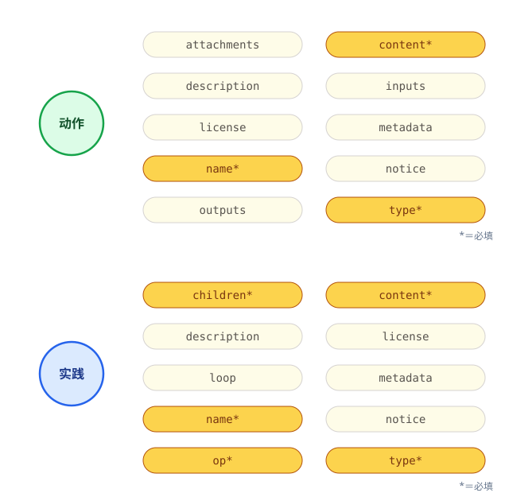
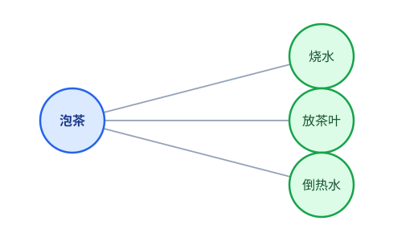
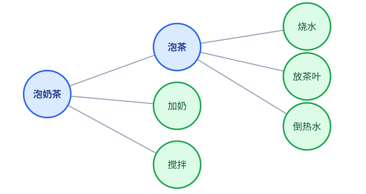
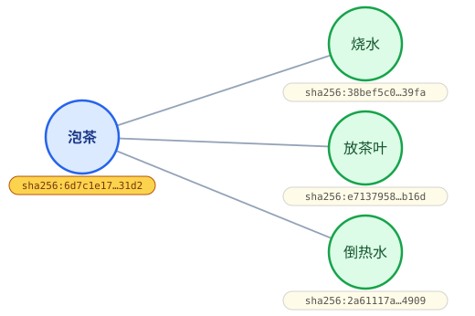

# POP——实践协议（Protocol of Practice）

<a href="README.md">English</a> | <b>中文</b>

一套把实践知识——"怎么做一件事"——定义为开放数据的协议：可发布、可链接、可验证、可组合。

**兼容 skill 生态**：每份 POP 文档都读作一个 skill——action 是原子技能，practice 是组合技能（组合技能的技能）。skill 可**无损映射为**文档（`name`/`description`/正文 → `name`/`description`/`content`，文件 → `attachments`），换来可验证的身份、链接与组合能力。反方向是**投影**：文档的数据流接线与 op 组合在 skill 侧没有序列化形式——把文档读作 skill 得到的是它的一个视图，而非无损编码。该映射是身份定义、不是导入通道：工具只回放导出物，外来 skill 靠重新撰写进入 POP。

**协议本体：[`pop-spec.md`](pop-spec.md)**——唯一规范性定义，版本 2.2.0。spec 只管协议本身；其余一切都在本仓库。

## 图解 POP

一份 POP 就是一个 JSON 树。叶子是**动作**——原子步骤；其余是**实践**——组合节点。两类节点的全部字段：



组合是子节点上的算子——`op` ∈ {`seq`, `par`, `choice`, `loop`, `set`}。"泡茶"就是三个动作的 `seq`：



实践可以嵌套实践——"泡奶茶"把"泡茶"整个当作其中一步：



节点没有 id：节点唯一的地址是它的内容哈希，根哈希是整棵树的 Merkle 根——哈希相同即内容相同，后代也包括在内（spec §3）：



## 快速开始

```bash
npm install -g @arshdelight/practi
practi init                                    # 创建配置家（默认 ~/.practi）
practi new make-tea --base tea.json -m "first"  # 从一份文档诞生实践文件夹（把上面的树存成 tea.json）
practi web                                     # 在本地 web UI 里浏览
```

Agent-first：把 [use-practi skill](skills/use-practi/SKILL.md) 交给你的 AI agent——`practi skill install` 会把它装到 agent 能看到的地方（默认 `~/.agents/skills`），之后的每一次记录 / 检索 / 复盘都由 skill 引导完成。

## 仓库内容

```
pop-spec.md              协议规范
sdk/                     @arshdelight/pop-sdk——官方 SDK + 一致性测试套件
cli/                     practi——`practi` 命令行：带本地历史的实践文件夹 + 可选的 hub 同步（基于 SDK）
skills/                  可安装的 agent skill（use-practi）
examples/                种子文档
```

**协议只是一套约定**：写实践不需要任何代码——实践就是一份 JSON 文档，起步零哈希。官方 SDK 实现 spec；任何其它实现方——hub、桌面应用、第三方工具——可以基于 SDK，也可以只依 spec 构建。spec 是唯一规范性定义。

## sdk/ — @arshdelight/pop-sdk

解析、哈希、校验与聚合（文档导入、内容寻址存储、聚合视图）的 spec 验证实现。其测试套件兼任一致性 harness：

1. 逐字节复验 Appendix A 测试向量（哈希硬编码在套件中，由 `sdk/scripts/vectors.ts` 再生成）
2. 验证 spec 自洽：导出/导入往返、校验不变式、聚合语义

一方工具（`cli/`）依赖它；正确性由 spec 与向量测试锁死——spec 保持规范地位，不被实现漂移架空。

```bash
npm run build -w @arshdelight/pop-sdk   # dist/——以 @arshdelight/pop-sdk 可导入
npm test -w @arshdelight/pop-sdk        # vitest（含 Appendix A 向量复验）
```

## cli/ — practi（`practi` 命令）

**带完整本地历史的实践文件夹，可选接 hub。** 一个实践就是一个自包含的文件夹：POP 是一份普通的 JSON 文件，用任何编辑器都能改；历史像 `.git` 一样放在旁边。除了你主动发起的同步（对 hub——比如 [practihub](https://practihub.com)——执行 `push` / `pull` / `clone`），没有任何东西离开本机。

```
green-tea/
  green-tea.json      pop——一份普通文档，随便用什么编辑
  .practi/            历史（类似 .git）：
    chain.json          提交 {seq, root, parent, message} + 分支指针
    nodes/              每个版本，内容寻址（哈希 = 身份）
    blobs/              附件字节
```

工作文件通常与头版本一致；不一致时就是有**未提交的改动**——`practi commit` 把它存成一个新版本。配置家（`~/.practi`）只放 `practi.json`（远端）和 `practi.auth.json`（凭据）；实践本身是普通文件夹，放在你存放文档的任何地方。

```bash
npm install -g @arshdelight/practi
```

```bash
诞生 · 编辑 · 同步（除非另有说明，都在实践文件夹内运行）
  practi new <name> [--base <file.json>] [-m <msg>]  在当前目录诞生一个实践文件夹；
                                   --base 用一份 pop 文档种入第一个版本
  practi commit [-m <msg>] [--amend]   把工作文件存为一个新版本
                                   （仅本地；与头版本相同时无可提交；
                                   --amend 改为替换头版本）
  practi export <hash> [-o <file>]       把任一版本写回成文档
  practi push [--force]            同步到 hub（首次推送在那里创建实例）
  practi pull                      拉取缺失的版本、快进分支、更新工作文件
                                   （有未提交改动时拒绝）
  practi clone <owner>/<name>[@branch] [--dir <path>]
                                   把 hub 上的实践克隆成本地文件夹（完整链）；
                                   只写 <name> = 你自己的实践

历史
  practi log [--branch <b>] [--limit N] [--json]   提交历史，tip 在前
  practi branch [name] [-d <name>] [--from <hash>]   列出（* = 当前）/ 创建 / 删除
  practi switch <branch>           切换分支；工作文件跟随头版本
                                   （有未提交改动时拒绝——先 commit）
  practi merge <branch>            能快进就快进，否则移动指针（树相同的提交
                                   是同一个——POP §9.1：一个根一行）
  practi history reword <seq> -m <msg> | squash <seq> | drop <seq> | reset <seq>
                                   改写本地提交链；工作文件原样不动
                                   （git reset 语义）——想留住就用 commit 收下，
                                   想丢弃就用 export 取回头版本

实践文件夹内
  practi show <hash> [--json] [--doc]   查看一个版本节点（hash 前缀即可）
  practi search [query...] [--json]     搜索这个实践的各个版本（BM25、标题优先、
                                   多词 AND 可跨字段、field: 限定、hash 前缀、
                                   标注出来的部分匹配档；--notes 连本地笔记一起搜）
  practi similar <hash>         这个实践内的内容近邻（字面 bigram 相似度——
                                   换了措辞、不共享字面的不会浮出）
  practi lint                   当前分支头的质量提示（只读，退出码恒为 0
                                   ——是待办清单，不是闸门）
  practi note add|list|edit|delete   钉在节点哈希上的学习笔记（.practi/notes.json，
                                   从不上传；`practi web` 的笔记边栏写的是同一个文件）
  practi blob add <file-or-url> [--name <name>]   把附件字节存进池（.practi/blobs/）
  practi gc [--apply]           释放孤儿 blob（默认 dry-run）
  practi web [--port 4317]      在本地 web UI 浏览实践：在实践文件夹内提供
                                   提交链、分支与逐版本的阅读器
                                   （wizard / 标准视图 / 树）；在别处提供
                                   practices 家目录（默认 ~/.practi/practices）的
                                   目录页——点进去就是阅读器

任何地方
  practi init [path]            创建配置家（凭据 + 远端；默认 ~/.practi）
  practi remote set <url> | remove    指向一个 hub
  practi login [--no-open] [--reauth]   OAuth 登录（PKCE，浏览器授权）；logout 吊销
  practi me                     查看当前登录账号与 scope
  practi config                 查看配置家与远端
  practi ls [--remote] [--json]  practices 家目录的跨实践概览
                                （每个实践的分支 / 头 / 版本数 / 未推送数）；
                                --remote 改为列出你在 hub 上的实践
  practi search --remote [query...] [--limit N] [--json]
                                hub 上的实践——公开的（hub 排名）加你自己的
                                （按名字／描述）；不带词 = 浏览最新的公开实践。
                                公开部分不登录也能用
  practi notifications [-n N] [--since D] [--until D] [--json]
                                hub 信箱（最近 N 条，或 since/until 时间段；
                                YYYY-MM-DD 或 ISO 日期时间）
  practi visibility <owner>/<name> public|private
                                申请公开（进入 hub 审核）或退回私有
  practi appeal submit <owner>/<name> --root <hash> --reason <text> | list <owner>/<name>
                                为被拒版本提交申诉 / 列出你的申诉
  practi delete <owner>/<name> --yes [--local <dir>]
                                永久删除 hub 实例及其版本；--local 连那个
                                实践文件夹一起删
  practi fix <file.json> [--dry-run]  把 POP 1.x 文档文件迁移到 2.0
  practi skill install | update | uninstall | import <dir> | export <ref>
  practi spec                   打印包内自带的 pop-spec.md（不联网）
  practi update                 经 npm 自更新
                                （每条命令会静默地每 10 分钟查一次 registry——
                                结果缓存，失败也缓存；给任何命令加
                                --checkversion 可立即重查）
  practi version | --version    查看 CLI 与 pop-spec 版本
```

随 pops 登记簿退役的命令（2026-10-20）：`edit` `list` `remove` `claim` `unclaim` `publish` `fetch` `repair` `migrate` `instance` `practice`——各自会打印去向（`ls` 于 2026-11-18 以文件夹模型语义回归：跨实践概览）。

一个实践文件夹对应 hub 上的一个**实例**——单 owner、GitHub 式的仓库，容纳一份 POP 的演进链与分支。`practi push` 在首次推送时在 hub 上创建它，`practi clone` 把整条链拉下来成为文件夹，`ls --remote` / `search --remote` 负责找到要克隆什么。内容寻址不受影响：hub 用同一份 SDK 在服务端重新推导哈希。

从源码运行：

```bash
npm run build -w @arshdelight/practi
npm link -w @arshdelight/practi   # 全局安装 `practi` 命令
```

两个包同仓为 npm workspace（根目录 `npm install` 即本地互链）。完整命令参考见 [cli/README.md](cli/README.md)；面向 agent 的操作指引见 [use-practi skill](skills/use-practi/SKILL.md)。

## 仓库语义（面向托管 hub）

协议只定义文档；若存在托管 hub，由它决定谁拥有文档、存活多久。spec §9.1 记录了 hub 应实现的仓库层契约：实践实例=单 owner 仓库，演进是一条提交链（`{ seq, root_hash, parent_hash?, message?, created_at }`）、分支是指向链的指针；一个哈希一份（内容寻址去重）；`{ hash }` ChildRef 在存储时解析（绝不存第二份）；`refines` 边是实例元数据并带反向索引；留存按链可达性——删除实例回收仅它引用的内容，与其它实例共享的内容幸存。

## 演进

自 1.0.0 起语义化版本：演进尽量只加可选字段（既有身份永不漂移）；破坏性变更升主版本。每次变更遵循：**更新 spec（附新测试向量）→ 一致性通过 → 同步实现方**。

## 版本历史

- **2.2.0**（2026-11-24）——§2：每个节点（action 与 practice）新增可选的 `notice` 字段，承载注意事项与踩坑，与操作说明分开。参与哈希；纯空白 ≡ 缺省（附录 A9）。§7：实践的「外部输入」与「最终输出」由声明的流与 flow 边派生——渲染方作为「需要准备 / 你会得到」两个列表呈现，作者无需在正文里复述。勘误：附录 A 里印出的 A8 哈希有一位数字写错（`…d6f4e…` 应为 `…d6f6e…`），测试套件里一直是对的。从未带 `notice` 的文档哈希不变；带了的文档需要 2.2.0 及以后的实现（更早的实现按 §8 拒收未知字段）。
- **2.1.0**（2026-10-19）——§9 传输契约按实例模型重写。认领时代的端点（`POST /pop`、`GET /pop/mine`、submit/unpublish/DELETE 及认领制搜索 scope）替换为实例/分支写契约：写入门 `POST /instances/:owner/:name/branches/:branch/revisions`（幂等存储+快进追加提交，一次调用）、分支链读取、绑头快进。§9.1 更名「仓库语义」：实例=单 owner 仓库独占一条提交链，留存按链可达性（取代声明表引用计数），§1 的「referencing is claiming」相应改写——留存是仓库层策略，与文档无关。无文档格式变更：哈希、§1–§8 与附录 A 不受影响。
- **2.0.0**（2026-10-19）——**破坏性**：`revisions` 字段（全部节点）与 `refines` 字段（practice）从文档模型移除。文档自此是纯内容快照；历史归仓库层（§9.1）：实例的提交链 `{ seq, root_hash, parent_hash?, message?, created_at }`，refines（改进关系）变为实例元数据——fork 边指向被改进实践的根哈希。携带被删字段的文档按 §8 拒绝（`E_SCHEMA`）——用 `practi fix` 剥除。从未带过这两个字段的文档在 v1/v2 下哈希一致；剥除后产生新哈希（旧哈希仍是旧内容的有效地址）。测试向量（附录 A）不变——没有任何向量用到被删字段。
- **1.1.0**（2026-09-03）——§5.1：行内媒体引用只对节点的附件列表解析；`` 外部 URL 目标不再是合法语法（`E_MEDIA_REF`）。外部字节可变、不可审计——审过的链接不会一直是审过的状态。`content` 里的普通 markdown 链接与附件指针可选的 `url` 抓取提示（§5）不变。从未用过外部媒体引用的文档不受影响；哈希不变。
- **1.0.2**（2026-08-27）——§9 不再点名具体认证机制：认证方式及其 scope 一律是 hub 策略。§6 澄清资源守卫（嵌套深度、载荷大小）是实现策略——以 `E_SCHEMA` 拒绝，绝不静默丢弃内容。无格式变更；哈希不受影响。
- **1.0.1**（2026-08-25）——校验澄清（§5.1）：行内代码块是代码，永不扫描其中的媒体语法（围栏代码块此前已是）。无格式变更；哈希不受影响。
- **1.0.0**（2026-08-22）——首发。节点不携带 id：内容哈希是唯一地址，根哈希是整棵树的 Merkle 根（同哈希 ⇒ 同内容，含全部后代）。子节点可内联，也可用 `{ hash }` 引用——身份上可互换。附件是内容寻址 blob，可带外部 url。
